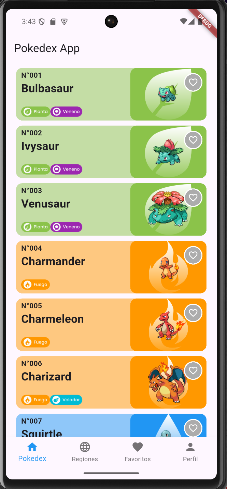
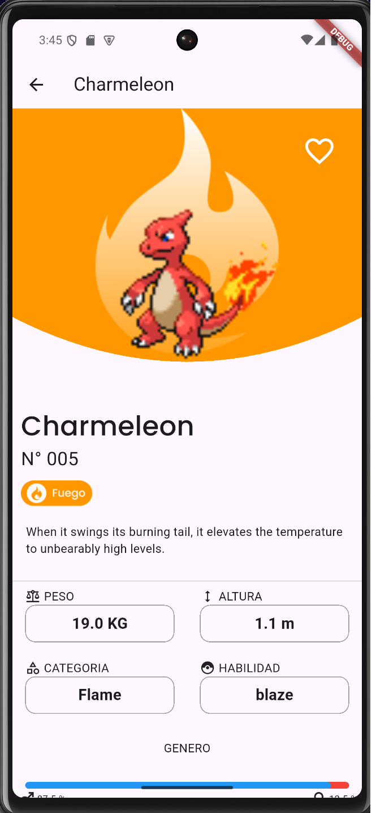
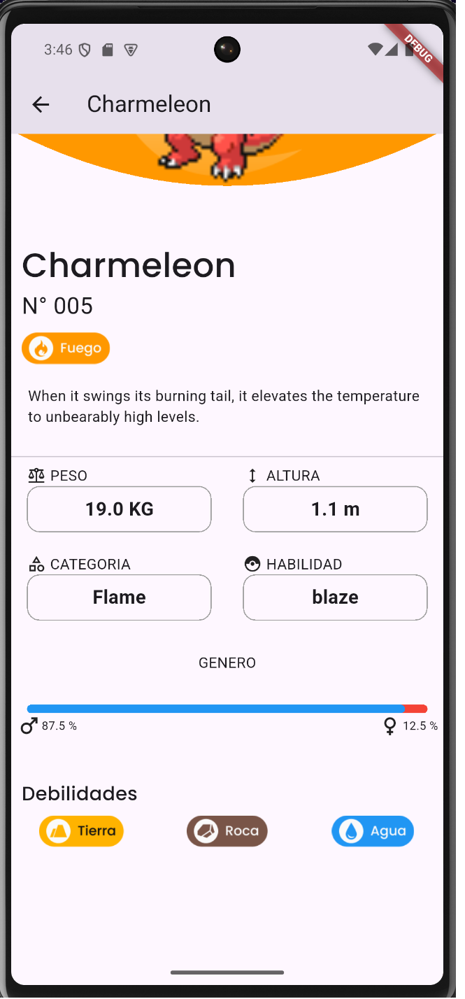
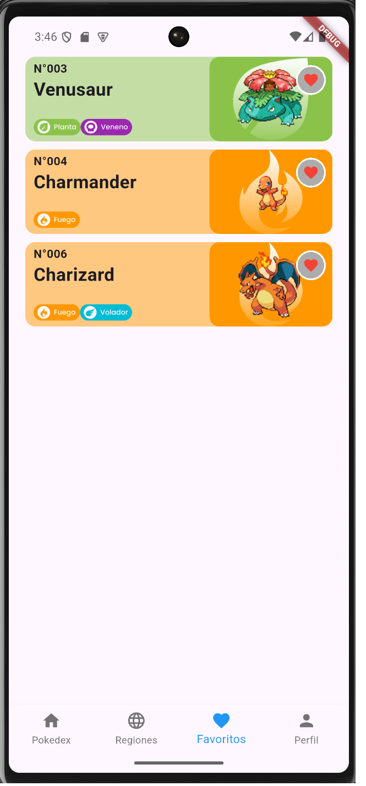

# Pokédex — Flutter + Riverpod 3

A Pokédex app built on the public [PokéAPI](https://pokeapi.co/). Browse every Pokémon in an infinitely scrolling list, open a detail view with species info and type weaknesses, and keep a list of favourites. UI in Spanish.

<!-- Screenshots: add 3–4 images (list, detail with weaknesses, favourites) -->
<p align="center">
  
  
  
  
</p>

## Features

- **Infinite scroll** — loads 20 Pokémon at a time (offset/limit) as you reach the end of the list, with a guard against duplicate loads.
- **Detail view** — height, weight and abilities, species description and category, and type weaknesses calculated from the API's damage-relation data.
- **Favourites** — mark Pokémon as favourites from the list or detail view, with an empty state when there are none.
- **Onboarding and splash screens.**

## Tech stack

| Area             | Choice                                                                         |
| ---------------- | ------------------------------------------------------------------------------ |
| Framework        | Flutter, Dart (^3.10)                                                          |
| State management | Riverpod 3 (`Notifier`, `NotifierProvider`, `FutureProvider`)                  |
| Networking       | Dio behind an `AppHttpClient` interface                                        |
| Models           | Hand-written immutable entities with `fromJson` and safe casts for nested JSON |
| UI               | google_fonts, custom widgets                                                   |

## Architecture

```
lib/
├── domain/          # Entities (BasicPokemon, PokemonDetails, PokemonSpecies, PokemonDamages)
│                    # and the PokemonRepository interface
├── data/
│   ├── network/     # AppHttpClient (abstract) + Dio implementation
│   ├── datasources/ # One API client per endpoint (list, details, species, type damages)
│   └── repositories/# PokemonRepositoryImpl
├── application/     # Riverpod providers and Notifiers (list state, pagination, details)
├── presentation/    # Screens, modals and widgets
├── helpers/         # Pure functions: weakness calculation, filters, formatting
├── constants/       # Colours, strings, lookup maps
└── core/            # Custom exceptions
```

**Why an `AppHttpClient` interface:** the data layer depends on an abstraction, not on Dio directly, so the HTTP client can be replaced with a fake in tests or swapped for another package without touching the repositories.

**Why no code generation:** I started with `riverpod_annotation` and Freezed, then switched to hand-written Notifiers and models early on. That kept the build simple and made every piece of state handling explicit while I was learning Riverpod 3's `Notifier` API.

## Getting started

Requirements: Flutter SDK (Dart ^3.10), an Android emulator or device. No API key needed.

```bash
git clone https://github.com/soulandbone/pokemon_redo.git
cd pokemon_redo
flutter pub get
flutter run
```

## Roadmap

- [ ] Re-enable name search and the type-filter modal on the list screen (widgets and filter logic exist but are currently commented out)
- [ ] Show load errors in the UI (error banner with retry) and a loading indicator at the end of the list
- [ ] Unit tests for the weakness calculation and filter helpers and Notifier tests with `ProviderContainer` and a fake `AppHttpClient`
- [ ] Persist favourites locally between sessions
- [ ] GitHub Actions CI (analyze + test)
- [x] Clean up unused dependencies (freezed, json_serializable, build_runner)

## Author

Gustavo Pavez Gikis — Flutter developer · [LinkedIn](https://www.linkedin.com/in/gustavo-pavez-5ba72814a/) · [Portfolio](https://portfolio-gpg.vercel.app/)
